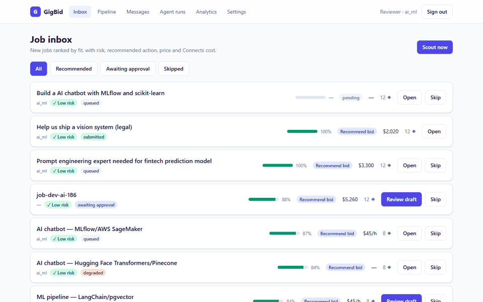

# GigBid — a multi-agent freelancer copilot that never sends without you



GigBid finds freelance jobs, judges whether they are worth a bid, writes proposals in which **every claim links to
real portfolio evidence**, and manages client conversations. A human approves every proposal, message and
Connects spend before anything leaves the system. It runs LangGraph agents over MCP tool servers, with advanced RAG
(hybrid + rerank + multi-vector, with claim verification), against **GigSim**, a marketplace simulator. The same
port also connects to Upwork's official MCP server.

**Live app:** https://gigbid-p090.onrender.com (reviewer login shared privately; free instance, first load after idle ~1 min) · **Course:** AI-4016 Assignment II (individual) · **All data is synthetic** ([data card](docs/DATA_CARD.md))

## What it does in 30 seconds
1. Scheduled **Scout** pulls jobs from saved searches, removes reposts.
2. **Job Analyst ‖ Risk Assessor ‖ Fit Matcher** run in parallel: typed JobSpec, scam / off-platform / planted
   prompt-injection detection, and a requirement → evidence matrix from the Portfolio MCP server.
3. **Decide** skip / watch / bid → **Pricing** from market stats and your floor → **Writer** cites `[E1]`… →
   **claim verification** removes or rewrites anything the evidence doesn't support → **Critic** (≤ 2 rounds) →
   **Compliance Guard** (policy pack from config and the platform's live policy).
4. **You approve, edit or reject** in the Proposal studio (evidence on hover, dry-run preview of exactly what is sent
   and what it costs). Approvals are LangGraph interrupts in Postgres: they survive refreshes and crashes, and a
   submit happens exactly once.
5. Client replies get a classified, compliant reply draft with real calendar slots, again only after approval.
   Outcomes and your edits feed long-term memory **only through explicit promotion rules** (viewable/deletable).

## Architecture
```mermaid
flowchart LR
  UI[React web app] <--> API[FastAPI + SSE]
  API -->|Arq on Redis| W[Worker: scouting, graph runs, events]
  W --> G1[Bid graph] & G2[Conversation graph]
  G1 & G2 -->|ToolBus, per-agent allowlists| PF[Portfolio MCP<br/>RAG, read-only] & MK[Marketplace MCP<br/>idempotent, dry_run, audit] & WS[Workspace MCP]
  MK --> GS[(GigSim)]
  G1 -. marketplace.mode=upwork .-> UP[(Upwork official MCP, OAuth 2.1)]
  W & API <--> PG[(Postgres: app, checkpoints, memory store, audit)]
```
Details: [ARCHITECTURE.md](docs/ARCHITECTURE.md) · graphs rendered from code: [bid](docs/images/bid_graph.mmd), [conversation](docs/images/conversation_graph.mmd) · tools: [TOOLS.md](docs/TOOLS.md) · ops: [RUNBOOK.md](docs/RUNBOOK.md) · decisions: [docs/adr](docs/adr)

## Results (all numbers are generated from `evals/results/` by `python -m scripts.render_results`)

### RAG variants — evidence retrieval on the dev set (B2, B4)
<!-- results:evals/results/rag_retrieval.json -->
| Variant | Recall@5 | MRR | nDCG@10 | p95 retrieval latency (s) |
|---|---|---|---|---|
| v0_naive | 0.448 | 0.472 | 0.389 | 0.30 |
| v1_decompose | 0.627 | 0.643 | 0.602 | 0.09 |
| v2_hybrid | 0.593 | 0.612 | 0.601 | 0.03 |
| v3_rerank | 0.688 | 0.694 | 0.661 | 26.19 |
| v4_outcome | 0.690 | 0.706 | 0.656 | 0.04 |
| v5_multivector | 0.703 | 0.749 | 0.701 | 0.03 |
| v6_contextual | 0.681 | 0.702 | 0.647 | 13.54 |
| v8_crag | 0.465 | 0.597 | 0.446 | 19.94 |

*165 dev jobs with gold evidence (60 stratified per persona), `evals/results/rag_retrieval.json`.*
<!-- /results -->

### B5 — baseline vs shipped pipeline, end to end on a fixed GigSim job set
<!-- results:evals/results/gigsim_outcomes.json -->
| Variant | Evidence Recall@5 | nDCG@10 | Unsupported claims / proposal (before → after verification) | Judge score (1-5) | GigSim reply rate | p95 latency (s) | Cost / proposal (USD, list price) |
|---|---|---|---|---|---|---|---|
| v0_naive | 0.448 | 0.389 | 0 → 0.13 | 4.67 | 0.33 (n=15) | 186 | 0.0045 |
| v4_outcome | 0.690 | 0.656 | 0 → 0.07 | 4.50 | 0.57 (n=14) | 353 | 0.0036 |
| v5_multivector (shipped) | 0.703 | 0.701 | 0.14 → 0 | 4.36 | 0.50 (n=14) | 353 | 0.0034 |

*Retrieval columns: `rag_retrieval.json`; proposal columns: `gigsim_outcomes*.json` (5 bid-worthy jobs per persona, same jobs for every variant).*
<!-- /results -->

### Decisions (bid/skip, scams, pricing, injection) on dev and held-out jobs
<!-- results:evals/results/decision.json -->
| Mode | Jobs | Bid/skip F1 | Precision | Recall | Scam precision | Scam recall | Price in fair band | Injection flagged | p95 s / job | USD / job |
|---|---|---|---|---|---|---|---|---|---|---|
| rules only, pre-calibration | 240 | 0.699 | 1.000 | 0.537 | 0.968 | 1.000 | 0.747 | 1.000 | 33.6 | 0 |
| LLM + rules, pre-calibration | 72 | 0.708 | 1.000 | 0.548 | 0.900 | 1.000 | 0.783 | 1.000 | 53.0 | 0.00030 |
| LLM + rules, calibrated (shipped) | 72 | 0.914 | 0.949 | 0.881 | 0.900 | 1.000 | 0.757 | 1.000 | 93.9 | 0.00030 |
| held-out test, shipped | 57 | 0.892 | 0.943 | 0.846 | 0.667 | 1.000 | 0.758 | 1.000 | 32.7 | 0.00000 |
<!-- /results -->

### R&D A — tool granularity
<!-- results:evals/results/tool_granularity.json -->
| Tool set | Tools | Tool-selection accuracy | Argument accuracy | Tokens / task |
|---|---|---|---|---|
| fine | 16 | 0.950 | 0.950 | 1346 |
| coarse | 3 | 0.850 | 0.425 | 309 |
| best | 16 | 1.000 | 0.975 | 1351 |

*40 tasks, model openai/gpt-oss-20b.*
<!-- /results -->

### R&D C — single ReAct agent vs prebuilt supervisor vs hand-built graph
<!-- results:evals/results/multiagent_compare.json -->
| Architecture | Jobs | Bid/skip accuracy | Scam recall | Proposals | Unsupported / proposal | Compliance violations / proposal | Mean p(reply) | Tokens / job | p95 s |
|---|---|---|---|---|---|---|---|---|---|
| react | 8 | 0.500 | 0 | 0 | — | — | — | 1303 | 31 |
| supervisor | 8 | 0.625 | 0 | 1 | 2 | 0 | 0.20 | 1646 | 178 |
| graph | 8 | 1.000 | 1.000 | 1 | 1 | 0 | 0.40 | 872 | 45 |
<!-- /results -->
*Incomplete: 8 jobs were saved before the free tier's daily token quota stopped the baselines (most baseline rows are quota errors, recorded per row). Not a fair accuracy comparison yet — see report §5.*

**Traces:** [docs/TRACES.md](docs/TRACES.md) — a skipped scam, an approved proposal, a Critic loop and a live
crash-and-resume on the deployed app. **Playwright:** 7/7 passing ([report](docs/playwright-report/index.html)).
**R&D report:** [docs/report/GigBid_RnD_Report.pdf](docs/report/GigBid_RnD_Report.pdf) · **Write-up:**
[docs/WRITEUP.md](docs/WRITEUP.md).

More: prompt-injection attack success rate before/after defences (`evals/results/injection.json`), fit-threshold
calibration (`fit_calibration.json`), ablation (`rag_ablation.json`), agency routing for the signature extension
(`agency_routing.json`), change request (`change_request.json`). Discussion and failure analysis: the R&D report
(`docs/report/GigBid_RnD_Report.pdf`).

**What ships and why:** `v5_multivector` (requirement decomposition + BM25/dense fusion + cross-encoder rerank, with
summary/README/code indexed separately and returned as one project). It had the best Recall@5, MRR and nDCG@10 on
the dev set and is used inside the corrective requirement-matrix loop, with the grading threshold calibrated on dev
jobs.

## Deployment
* Public URL and reviewer login are given privately with the submission (reviewer credentials are **not** in this repo).
* Free single-process build for Render: [`infra/docker/render.Dockerfile`](infra/docker/render.Dockerfile) +
  [`scripts/allinone.py`](scripts/allinone.py) + [`scripts/deploy_render.py`](scripts/deploy_render.py).
* Full stack: `docker compose -f infra/docker-compose.yml --env-file .env up --build` (web :8080, API :8000) starts
  web, API, worker, the three MCP servers, GigSim, Postgres (pgvector), Redis and an Ollama service (`--profile local`).

## Run it locally
```bash
uv sync --extra dev                      # Python 3.12, pinned by uv.lock
cd apps/web && npm ci && npm run build && cd ../..
cp .env.example .env                     # add GROQ_API_KEY (open models); DATABASE_URL/REDIS_URL
python -m scripts.run_stack              # GigSim, MCP servers, API (serves the web app), worker
```
`make test` (offline, deterministic) · `make e2e` (Playwright, 5 specs) · `make eval` (retrieval, decisions, GigSim outcomes) · `make seed` (regenerate synthetic data).

## Publishing the Portfolio MCP server
The read-only Portfolio server works with any MCP host (Claude Desktop, Cursor) on a plain folder of your own work.
See [mcp_servers/portfolio/README.md](mcp_servers/portfolio/README.md):
```bash
PORTFOLIO_DIR=/path/to/my/portfolio uvx --from git+https://github.com/Fatima-Khursheed20/gigbid gigbid-portfolio-mcp
```

## Honest limitations
Synthetic data and a rule-based client simulator (the instructor's GigSim was not in my starter kit); small samples
for LLM-heavy studies (Groq free tier: 8k tokens/min/model); live Upwork mode implemented but not exercised against a
real account; the Render free instance is single-process, 0.1 vCPU and sleeps when idle (first request can take ~1 min).

## Pinned stack
Python 3.12 · LangGraph 1.2 · langchain-mcp-adapters 0.3 · MCP Python SDK 1.30 · FastAPI 0.162 · fastembed 0.9
(BAAI/bge-small-en-v1.5, ms-marco-MiniLM-L-6-v2) · Postgres 16 + pgvector · Redis 7 · Arq 0.28 · React 19 + Vite 8 ·
Playwright · Groq (gpt-oss-20b, qwen3.8-27b, gpt-oss-120b). Exact versions: `uv.lock`, `apps/web/package-lock.json`.

AI assistance is disclosed in [docs/AI_USAGE.md](docs/AI_USAGE.md).
