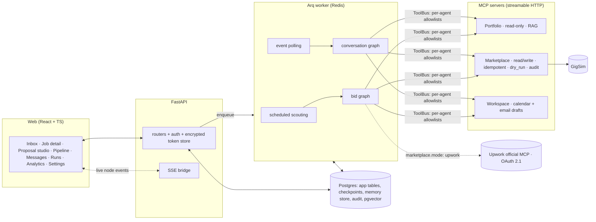

# Architecture

## The two graphs (rendered from code: `docs/images/*.mmd`, regenerate with `python -m scripts.gen_docs`)

**Bid graph** (`agent/graphs/bid_graph.py`, one thread per job): `intake` → **`analyst` ‖ `risk` ‖ `matcher`**
(fan-out with `Send`, joined by a waiting edge) → `decide` → skip/watch END, or `pricing` → `writer` →
`verifier` (claim verification) → `critic` → `revise`→`writer` (at most `budgets.max_revisions` = 2) →
`compliance` (blocked → END with reason) → `prepare_preview` (marketplace dry_run) → `human_approval`
(`interrupt()`) → approve: `submit` · edit: `apply_edit` → `compliance` … · reject: END.

**Conversation graph** (`agent/graphs/conversation_graph.py`, one thread per client thread): `load_thread` →
`classify` (question / negotiation / interview_request / scam_signal) → [`find_slots`] → `draft_reply` →
`msg_compliance` → `msg_approval` (`interrupt()`) → `msg_send` (+ tentative calendar holds) / `msg_apply_edit` / END.

Every node is wrapped by `agent/nodes/_base.py::node`: step and token budgets (→ visible *needs attention*),
timeout, one bounded retry, `MarketplaceUnavailable` → *degraded*, anything else → *dead letter*, per-node token/
cost/latency accounting and execution-trace events.

## Why each agent exists

| Agent | Why it is a separate agent | Model (open profile) | MCP access |
|---|---|---|---|
| Scout | runs on a schedule, de-duplicates by client+body fingerprint, never needs an LLM | — | marketplace read |
| Job Analyst | turns messy posts into a typed `JobSpec`; untrusted text is neutralised and delimited | gpt-oss-20b | none |
| Risk Assessor | rules are a floor the LLM cannot talk its way past (an injection can't un-flag a scam) | gpt-oss-20b + rules | marketplace read (client history) |
| Fit Matcher | retrieval + corrective grading, no LLM: every requirement → evidence or an explicit "none" | — (cross-encoder) | portfolio |
| Pricing Strategist | deterministic from market stats, client budget, user floor, Connects value | — | marketplace read |
| Proposal Writer | strongest model; may only claim what the evidence pack supports, cites `[E<n>]` | gpt-oss-120b | portfolio |
| Claim verification | separates *checking* from *writing*; deterministic tech-name check on top of the LLM | qwen3.8-27b + rules | — |
| Critic | quality gate with a hard loop limit; rules always block, LLM nits only below a score | qwen3.8-27b + rules | portfolio |
| Compliance Guard | enforces the policy pack from config + the marketplace's live policy; removes, then blocks if unfixable | gpt-oss-20b + rules | none (policy handed over in state) |
| Client Liaison | conversation graph; intent rules are a floor; proposes real calendar slots | gpt-oss-120b | marketplace, workspace, portfolio |

The analysis agents run in parallel because they are independent and latency matters for an inbox; the writer
pipeline is sequential because each step consumes the previous structured hand-off (`agent/handoffs.py`).

## State vs execution trace vs long-term memory
- **State** (`agent/state.py`): typed `TypedDict`s with reducers on every key parallel branches write
  (`analyses_done`, `errors`, `steps`, `tokens`, `usd`, `degraded`). Checkpointed by `AsyncPostgresSaver`.
- **Execution trace** (`agent/tracebus.py`): tool names, masked arguments, results, latencies → `run_events`
  table + SSE + LangSmith (when configured). Never written into state.
- **Long-term memory** (`agent/memory/`): `AsyncPostgresStore`, namespaces `("style", user)` and
  `("outcome", user)`. Observations land in staging namespaces; `promotion_rules.py` is the only code that writes
  promoted memory (style: ≥3 edits across ≥2 jobs; outcome: ≥3 real outcomes in a category). Users delete items
  in Settings; deletions leave a tombstone so they are not re-promoted.

## The marketplace port (R1)
`agent/marketplace_port.py` defines `MarketplacePort`. `GigSimPort` calls GigBid's Marketplace MCP server;
`UpworkLivePort` (`mcp_servers/marketplace/adapters/upwork_live.py`) calls the official Upwork MCP server through
`MultiServerMCPClient` with per-user OAuth. `make_port` picks one from `marketplace.mode`. Nodes only see the port.

## Trace id
`X-Trace-Id` is set by the API middleware, copied into the graph run's metadata, sent as a header on every MCP
call by `ToolBus`, read by each MCP server (`mcp_servers/common.py::trace_from`) and stored on every audit-log
row (`mcp_servers/marketplace/audit.py`).
